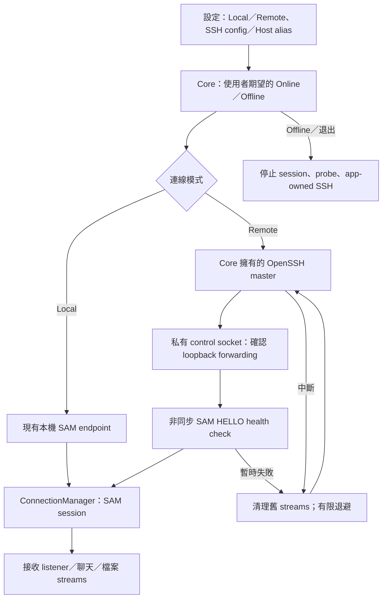

# Java I2P 對齊與 Rust 移除計畫

日期：2026-10-10。

前半部記錄已完成的 Rust 移除與 Java 基準對齊；其非目標只適用於該次工作。最新需求與待核准的 Core／GUI 變更見下方「Remote SSH／SAM 連線功能計畫」。

## Task

使用者要求：先完全移除 Rust 的這塊，儲存此次 research、結果與 `plan.md`，並對齊最新版 Java I2P 搭配最新 JDK LTS。

## 決策與研究結果

- 保留 Qt／C++ 客戶端，以 SAM 連外部 Java I2P router，不將客戶端改寫成 Java。
- 移除 optional Rust SAM parser／command builder、動態載入 adapter、設定開關及 Rust 專用測試；正式路線只使用現有 C++ 實作。
- Java I2P 官方 I2CP／Streaming／Datagram SDK 最完整；非 JVM client 使用 SAM 可以保持低耦合。這不要求把 Java SDK 或完整 router 嵌入 Qt app。
- 目前基準為 **Java I2P 2.13.0 + Temurin JDK 25 LTS 25.0.4.1+1**。JDK 27 是 non-LTS，不因其版本號較高而選用。
- i2pd 不再是本次設定範例的主路線；保留既有 SAM／SOCKS5 功能，不刻意破壞其他相容 router。
- Rust SDK／router 的比較保留為歷史研究，不是待執行的遷移計畫。
- 完整研究來源與限制見 [I2P／i2pd 語言與 SDK 研究](docs/I2P_LANGUAGE_SDK_RESEARCH_2026-10.md)。

## 核驗的版本與來源

| 項目 | 基準及來源 |
| --- | --- |
| Java I2P | 2.13.0，官方公告 2026-07-20；Maven Central 的 core／router／streaming 最新 release 皆為 2.13.0 |
| 最新 JDK LTS major | 25，Oracle roadmap 明示 25 為 LTS、27 為 non-LTS |
| Temurin 最新核驗 patch | Adoptium macOS ARM64 API 回傳 `25.0.4.1+1-LTS`，2026-08-21 更新 |
| mise 識別碼 | `java = "temurin-25.0.4+101.0.LTS"`；這是供應商 semver 表示，實際 Java 顯示 25.0.4.1+1 |

來源：

- [Java I2P 2.13.0 官方公告](https://i2p.net/en/blog/2026/07/20/i2p-2.13.0-release/)。
- [Maven router metadata](https://repo.maven.apache.org/maven2/net/i2p/router/maven-metadata.xml)、[streaming metadata](https://repo.maven.apache.org/maven2/net/i2p/client/streaming/maven-metadata.xml)。
- [Oracle Java 支援時間表](https://www.oracle.com/java/technologies/java-se-support-roadmap.html)。
- [Adoptium 最新 JDK 25 macOS ARM64 metadata](https://api.adoptium.net/v3/assets/latest/25/hotspot?architecture=aarch64&image_type=jdk&os=mac&vendor=eclipse)。
- [官方 SAM 規格](https://i2p.net/en/docs/api/samv3/)。

## Acceptance criteria

1. 應用 source、qmake、設定範例不再使用 Rust adapter、Cargo、Rust 環境開關或 required-Rust 模式。
2. Rust 專用 source／crate／FFI／smoke assets 移出專案，研究與決策仍可追溯。
3. 保留現有 C++ SAM wire commands、parser、SOCKS5、timeout、profile、聊天及檔案傳輸行為。
4. `mise.toml` 只固定本專案 JDK 與 Java I2P 驗證基準，不更動全域 runtime 或現有 router 服務。
5. 純 C++ app 可建置，SAM parser 回歸測試通過，Java I2P core／router 版本 entry points 能在固定 JDK 下執行。
6. `plan.md`、研究報告及 `AGENTS.md` 不再被現有 `*.md` 忽略規則排除。
7. 不宣稱未實測的 live SAM、tunnel、peer、聊天／檔案功能已驗證。

## 變更分類與範圍

此變更屬 Core Code，因為 SAM parser、session 與 stream 的建置路徑影響所有連線。以移除 Rust 分支、保留 C++ fallback 為唯一行為變更，逐行核對相對本次工作前的備份，而不是將既有未提交改動還原到 Git HEAD。

修改範圍：

- `I2PSamMessageAnalyser.cpp/.h`：移除 adapter 狀態與 config 參數，直接使用既有 C++ parser。
- `SessionController.cpp`、`I2PStream.cpp`：移除 Rust-first builders、required-mode gates／錯誤訊息，保留 C++ command bytes。
- `I2PChat.pro`：取消 Rust adapter source／header 註冊。
- `application.ini.example`：移除 required-Rust 設定，說明 Java I2P SAM 必須另外啟用。
- `.gitignore`、`AGENTS.md`：取消 Rust 規則／指引，加入僅針對指定文件的保存例外。
- `mise.toml`：專案 JDK pin、I2P baseline、`verify-java-i2p` task。
- `tools/sam_cpp_smoke.cpp/.pro`：不依賴 Rust 或 live router 的 C++ parser 回歸案例。
- `tools/verify_java_i2p.py`：固定 Maven artifacts 的 SHA-256 和版本檢查，不啟動 router。

非目標：不更改聊天協定、GUI、C++ standard、Qt 版本、目的地私鑰、使用者 profile、全域 mise 設定、現有 router／SAM／proxy 服務，也不做 Rust router rewrite。

## 執行與驗證命令

### 客戶端建置

```sh
qmake I2PChat.pro "CONFIG += release"
make -j8
```

### C++ SAM parser 回歸

```sh
mkdir -p build/sam-cpp-smoke
qmake tools/sam_cpp_smoke.pro -o build/sam-cpp-smoke/Makefile
make -C build/sam-cpp-smoke -j8
./build/sam-cpp-smoke/sam_cpp_smoke
```

### 專案 JDK 與 Java I2P

```sh
mise install
mise exec -- java -version
mise run verify-java-i2p
```

驗證器會從 Maven Central 的 HTTPS 路徑取得固定 2.13.0 core／router jars，存入被忽略的 `build/java-i2p/2.13.0/`。SHA-256 是此次首次取得 artifacts 後固定的摘要，不宣稱為 Maven 發布的 `.sha256` 檔或簽章驗證。摘要不符時失敗，不自動覆寫可疑檔案。

這項 check 只確認 JDK major、artifact bytes 與版本 entry points；不是完整 router startup、SAM 或匿名性驗證。實際 JDK patch 由 mise 的完整 pin 控制。

### Java I2P router 設定

透過 Java I2P 自己的安裝與設定流程啟用 SAM，client 範例使用 `127.0.0.1:7656`。需要以本專案 JDK 手動啟動既有 Java router 時，可以使用下列命令，先把路徑換成已安裝的 2.13.0：

```sh
mise exec -- /absolute/path/to/i2p/runplain.sh
```

本次不執行此啟動命令，不部署或重啟已有服務。若既有服務使用 launchd／systemd／Windows service，它的 Java runtime 必須另行核對；專案 mise pin 不會自動改變服務的 JVM。JDK 25 相容性目前只以版本 entry points 驗證，完整 router startup 尚待隔離環境測試。

## 結果紀錄

- Rust core 分支、adapter、crate、FFI、專用 smoke 與過期 FFI handover 已移出專案。
- C++ parser 成功／錯誤／短輸入案例：19 個通過。另以修改前備份比對，確認 C++ parser body 完全相同。
- 純 C++ release build：通過，使用 Qt 6.11.2、macOS SDK 26.2，產生 ARM64 `I2PChat.app`。第一次建置被舊 SDK 15.5 快取擋住，封存舊快取／產物後重新建置成功，未修改部署目標。
- 專案 Temurin JDK：已安裝 25.0.4.1+1 LTS，未改全域預設。
- Java I2P core／router 固定 SHA-256 與版本 entry points：通過。輸出 core 2.13.0、router 2.13.0-0、API 0.9.70，使用 Temurin 25.0.4.1+1 LTS。
- Java 驗證器的失敗路徑：錯誤 JDK major 與錯誤 artifact SHA-256 都會拒絕，且不觸發下載；兩項測試通過。
- Diff、文件保存與無 Rust runtime 相依檢查：通過。Source／qmake／設定範例／新 Makefile 無 Rust SAM references，ARM64 app 無 Rust adapter symbols；研究、計畫與指引皆可由 Git 保存，核心變更的 `git diff --check` 通過。
- 額外 ACP 唯讀 review 未完成：OMP 因安裝 SDK 18.8.7 與受限 adapter 核准的 18.8.0 不一致而拒絕啟動；允許的 Codex fallback 逾時。未降低權限或修改 dispatch 設定，未宣稱外部 review 通過。

## 備份與回復

Rust 檔案採可逆封存，不做不可逆銷毀。備份位置：

```text
$HOME/temp/i2pchat-backups/20261010T091754Z/
  before/                 本次要修改的原始 source、設定與指引
  removed/                已移出專案的 Rust 相關檔案及生成產物
  manifest.json           修改前檔案 SHA-256
  removed-manifest.json   封存檔案 SHA-256
  status-before.txt       開始前的 Git status
```

封存核對了 1,037 個檔案的 SHA-256。舊 SDK 快取及 90 個建置檔另封存在同一備份的 `stale-build/`，不做不可逆刪除。`mise-ops` 的獨立變更備份在 `$HOME/.local/state/mise-ops/backups/change-20261010T091848Z-ydi3l1k8/`；本次原本沒有專案 `mise.toml`。

需要回復時，先重新檢查目前工作區，再選擇性複製 `before/` 與 `removed/` 中的檔案回原路徑。不要用 `git reset`／`git clean` 或整批覆寫來回復，避免損失其他未提交變更。已安裝的 JDK 可以保留；不需要解除安裝全域 Rust／rustup。

## 剩餘驗收

- 在隔離 profile 和指定 JDK 下測試完整 Java router startup／shutdown 與 SAM。
- 用兩個 peers 驗證聊天、目的地持久化、重新連線、SOCKS5 和檔案傳輸。
- 若要修改既有 router 的 JVM 或服務設定，先確認部署目標、備份、停機風險與回復方式，再取得明確授權。

## Remote SSH／SAM 連線功能計畫

狀態：依使用者核准範圍完成本機實作；乾淨 build 的 31 個 QtTest、19 個 SAM parser 案例及正式 ARM64 release build 通過。de4 SSH 已實測，但被 host-key 驗證擋住，尚未驗證 forwarding、SAM 或真實 I2P peers。

### 目標與已確認選擇

- 設定介面可選 Local 或 Remote。Local 使用外部本機 Java I2P 的 SAM；Remote 可連相容 SAM 3.1 的 i2pd，例如 de4 VPS。
- Remote 可選 SSH config 檔、其中的 literal `Host` alias（SSH profile），設定遠端 SAM host／port，以及僅綁定 `127.0.0.1` 的本機 forwarding port；預設自動分配本機 port。
- 使用系統 OpenSSH、SSH key／ssh-agent；不新增密碼或 MFA 對話框，不保存認證資料，不讀取私鑰。
- 選擇 Remote 後，在按 Online 或 health check 時自動建立 forwarding；僅修改設定不建立網路連線。
- Online 期間的暫時連線失敗最多自動重試三次，退避 1、2、4 秒；短暫成功不立即重置重試額度，避免 flapping 造成無限重連。認證、host key、設定與固定 port 衝突為終止錯誤。
- Offline、模式切換前、程式結束時，只停止本程式建立的 SSH 程序及 SAM session，不碰使用者已有的 tunnel／router。

### 架構與生命週期

此功能屬 Core Code：SAM endpoint 必須一致用於 session、incoming listener、contact streams 與檔案傳輸，不能只讓設定 UI 啟動一個 SSH 程序。



- 新增 Qt `QObject` transport controller，以 `QProcess`、socket、timer 管理 SSH、probe、重試及可見狀態；不加 Rust、libssh、背景 daemon 或第三方依賴。
- Remote 先建立前景 `ControlMaster`，使用唯一私有 control socket，禁止持續背景執行與繼承額外 forwarding；再透過 `ssh -O forward` 請求固定 loopback forwarding。此確認比 `QProcess::started` 或單純 port-open 更可靠。
- 使用 argv 而非 shell 拼字串；alias、host、port 做驗證。指定 `BatchMode=yes`、`StrictHostKeyChecking=yes`，不自動接受新 key、不更新 host keys、不轉送 agent／X11、不執行 LocalCommand。
- SSH config 是使用者選擇的受信任 OpenSSH 設定；OpenSSH 本身仍可能依 config 使用 ProxyJump／ProxyCommand。profile 清單解析不使用 `ssh -G`，不執行 `Match exec`。列出 literal Host aliases；wildcard／Include 中的 alias 可手動輸入並由 OpenSSH 解析。
- 所有非同步完成回呼需核對 attempt generation／期望狀態；舊 probe／process／session 不得讓已 Offline 的 Core 再變 Online。
- `ConnectionManager` 僅在完全 stopped 時替換 endpoint。Remote session／streams 明確使用 `NoProxy`，不把 localhost forwarding 再送進既有 SOCKS5 proxy；Local 的 SOCKS5 行為保留。
- SAM session 失敗不得建立 incoming listener；Core 清理以 queued callback 執行，避免在 sender 的 signal stack 中刪除物件。Remote 的失敗進入同一有限重試預算。
- 新增 routing 設定只能在 Offline 時修改；Online 時 health check 使用實際 active endpoint，不啟動第二個 SSH master。Offline 的測試可用未儲存設定，完成後關閉臨時 tunnel。

### UI、設定與狀態

- `form_settingsgui.ui/.cpp/.h` 新增 Connection 頁面，保留既有 Network 頁面的 SAM／signature／tunnel options，不重排其他設定。
- 新設定鍵：`Network/RouterMode=local|remote`、`SSHConfigFile`、`SSHProfile`、`SSHRemoteSAMHost`、`SSHRemoteSAMPort`、`SSHLocalForwardPort`。不重用舊 `ConnectionMode=direct|socks5`。
- `SAMHost`／`SAMPort` 保留作 Local endpoint；Remote 預設遠端為 `127.0.0.1:7656`，不要求將 de4 SAM port 公開到 Internet。
- SSH config 可透過檔案選擇器指定，Host alias 下拉可編輯；不自動讀取或展示私人 key／認證內容。
- health 狀態分為 SSH 程序／forwarding、SAM HELLO、正式 SAM session ready；主畫面不能只依儲存的 host 或「process started」宣稱連線成功。
- health check 驗證有界、完整的 `HELLO REPLY RESULT=OK VERSION=3.1`，有 timeout，拒絕錯誤服務／版本／過長回覆。Remote Online 時週期性檢查 SAM，失敗停止舊 streams 並有限重試。
- 錯誤使用分類後的訊息與必要操作提示，不寫入原始 SSH stderr、密碼、key 或完整私人 config。首次使用必須先在終端確認 host key，必要時解鎖 ssh-agent。

### 預定檔案範圍

- 新增 `src/backend/RouterConnection.h/.cpp`：共享設定、profile alias 解析、SSH／SAM controller。
- `Core.h/.cpp`：持有 controller、Online gate、期望狀態、錯誤／重試及 health API。
- `ConnectionManager.h/.cpp`：stopped-only endpoint 設定、失敗時不建立 listener。
- `SessionController.h/.cpp`、`I2PStream.h/.cpp`：Remote endpoint 明確略過 SOCKS5；保留 Local 行為和 wire protocol。
- `form_settingsgui.ui/.h/.cpp`、`form_Main.cpp`：模式、SSH config／profile、health 操作及實際連線狀態。
- `I2PChat.pro`、`application.ini.example`、`AGENTS.md`：註冊模組、設定範例、可執行開發指引。
- 新增獨立 Qt 測試 target／fixtures 至 `tools/`；QtTest 不加入正式 app modules。

### 驗收與驗證

1. 用暫存 SSH config／假 SSH executable／loopback SAM server，驗證模式與設定 round trip、Host alias、安全 argv、forwarding acknowledgement，再取得 SAM HELLO ready。不得讀私人 SSH config 或連 de4。
2. 假 SSH 覆蓋 key／host-key／config 失敗、SSH 不存在、固定 port 衝突；認證與 host-key 失敗不得重試或降級至不安全旗標。
3. 假 SAM 覆蓋正常／分段／錯誤版本／非 SAM／過長回覆／timeout。TCP connect 成功但 HELLO 失敗不得啟動正式 session。
4. 覆蓋 tunnel 中斷、退避重試上限、短暫成功後再次中斷、連線中按 Offline、health 中退出、舊回呼和重複 start／stop；不得殘留 app-owned process 或誤殺其他程序。
5. 確認 Remote 的 session／所有 streams 使用同一有效 loopback endpoint 與 NoProxy；Local 的原設定與 SOCKS5 路線不被覆蓋。
6. 設定頁保存／載入、Online routing 鎖定、主畫面狀態以 Qt 測試／offscreen smoke 檢查；測不到的路徑明確列出。
7. 整合後跑新測試、既有 19-case C++ SAM parser smoke、完整 release build、限定此次變更的 diff 檢查。不把 build 成功等同 live I2P 成功。

### 邊界、風險與回復

- 此階段不自動下載、嵌入或啟停本機 Java router；Java I2P 2.13.0／JDK 25 LTS 基準不變。Local 表示既有本機 SAM 路線。
- Remote 需要支援 ControlMaster／`-O forward` 的 OpenSSH；macOS／Linux 為主要目標，Windows 不承諾此能力，缺少支援時顯示明確錯誤，不靜默改用另一種安全性較低的 route。
- SSH 啟動與 health probe 使用非同步流程；停止 app-owned SSH 程序仍使用短暫同步等待，現有 SAM client 的 `waitForConnected` 也保留，不宣稱整個連線生命週期完全非阻塞。
- SAM HELLO 不證明 I2P tunnels 建立、peer 可達、聊天／檔案成功或匿名性；正式 session 與兩個 peers 的 live 驗證另行記錄。
- 不登入 de4、不變更 VPS 的 sshd／i2pd／SAM／firewall、不信任新 host key、不重啟服務。實機驗收須另取得目標與許可。
- 此次修改前 17 個檔案已逐一 SHA-256 核對備份至 `$HOME/temp/i2pchat-backups/remote-ssh-20261010T111020Z/`。回復只選擇性使用此次 `before/`，保留既有未提交改動，不使用 reset／clean。
- OpenSSH 參數依據：[ssh(1)](https://man.openbsd.org/ssh.1)、[ssh_config(5)](https://man.openbsd.org/ssh_config.5)；SAM 協定依據：[SAM v3](https://i2p.net/en/docs/api/samv3/)。

### GitHub repository

- 依使用者要求，以 `gh api` 建立 [fun-ed/i2p-chat](https://github.com/fun-ed/i2p-chat)，名稱沿用原 remote 的 `i2p-chat`。
- 建立前 `gh api user --jq .login` 確認為 `fun-ed`，同名 repository 查詢為 404；建立後獨立查詢確認 owner `fun-ed`、visibility `public`、`private=false`、size `0`。
- Repository 建立完成當時為空；該步驟未 commit、push 或更改原 `origin`（`zoonderkins/i2p-chat`）。後續公開快照的提交前驗證見下方紀錄。

### 實作與驗證結果

- Connection 頁面已加入 Local／Remote、SSH config 檔案選擇器、可編輯 Host alias、遠端 SAM endpoint、自動／固定本機 forwarding port、health 按鈕與狀態說明。
- `RouterConnectionController` 經私有 ControlMaster、control check、forward acknowledgement 與完整 SAM HELLO 後，才通知 Core 建立 Remote session。所有 Remote session／streams 明確使用 loopback endpoint 與 NoProxy。
- Core 已整合期望 presence、Connecting、停止、有限重試和 generation cancellation；失敗 session 不建立 incoming listener，舊 queued 回呼不會消耗新 attempt 的額度。路線以每次明確 Online 要求的設定 snapshot 固定。
- 最多三次重試以同一次 Online 要求計算，不因短暫成功自動重置；Offline 後再 Online 可重新開始。認證／host-key／設定／固定 port 錯誤直接回到 Offline。
- Online 或 health-busy 時不能保存 routing draft；Online health 沿用實際 tunnel，Offline health 可測未保存設定且不建立正式 session。設定保存／再載入與 Connection 頁面在固定對話框內的 layout 已通過 offscreen 測試。

| 檢查 | 實際結果 |
| --- | --- |
| 新 QtTest，乾淨獨立目錄 | 31 passed、0 failed、0 skipped；含分段 HELLO、錯誤服務／版本／長度／timeout、SOCKS5、SSH terminal errors、forward port 衝突、Core gate、重連上限／flapping、取消、route snapshot、重複 queued failure、GUI round trip／layout／保存鎖定 |
| 舊 C++ SAM parser smoke | 19 個案例通過 |
| 正式 release build | 通過；Qt 6.11.2、SDK 26.2、C++17，產生 ARM64 `I2PChat.app` |
| 系統 OpenSSH 參數 | 對隔離 fixture config 做 `-G` 離線解析，實際 source 的 master argv 與 strict options 被接受；沒有連線、Include／Match exec 或私人 config 讀取，原始輸出未公開 |
| Source diff whitespace | `git -c core.whitespace=cr-at-eol diff --check` 在此次已追蹤範圍通過；保留既有 CRLF 檔案，不將行尾當成 trailing whitespace |
| GitHub 建立步驟 | 當時確認 `fun-ed/i2p-chat` 為 public 空 repo；該步驟沒有 stage、commit、push 或 remote 變更 |

可重現的新測試命令（repository root）：

```sh
mkdir -p build/remote-connection-test
qmake tools/remote_connection_test.pro -o build/remote-connection-test/Makefile
make -C build/remote-connection-test -j8
QT_QPA_PLATFORM=offscreen ./build/remote-connection-test/remote_connection_test
```

本次最終完整驗證使用全新目錄 `build/remote-connection-clean-76f4dw3t/`，確認不依賴先前殘留的 app bundle。修正了初次編譯發現的 QProcess incomplete type、test target 缺少 Git metadata macros，以及 console test 不應執行 app bundle post-link hook；目前都已通過建置。

另以先失敗、再修正的回歸案例確認 Local health 不會誤稱「temporary tunnel closed」。GUI 的正常模式／欄位保存與 layout 案例也通過。Qt 6 測試仍會出現舊 style combo auto-slot／字型警告，未修改與此次連線功能無關的 style 邏輯。

尚未執行：真實 OpenSSH forwarding、de4 i2pd SAM、長時間週期性監測 soak、兩個真實 peers 的聊天／檔案傳輸、Qt 5.15 或 Linux 建置。本機 fixture 通過不是這些實機驗收的替代品；本機 Java router 自動啟停與 Windows Remote 仍不在此範圍。

### de4 實機 health check 結果

- 依使用者要求，使用其指定 SSH config 的 literal `Host de4`。以實際 `RouterConnectionController` 的獨立測試程式啟動一次 Remote health check，遠端 SAM 目標為 `127.0.0.1:7656`，本機 port 自動分配，不建立正式 SAM session。
- 結果為 `SSH host-key verification failed`，約 1.66 秒結束。失敗發生於 SSH 登入及 forwarding 前，沒有執行 SAM HELLO；不能據此判定 de4 的 i2pd／SAM 不可用。
- 嚴格驗證的受限診斷確認是缺少可信 host key，未報告既有 key mismatch。profile 設定為 `StrictHostKeyChecking=no`，有效 `UserKnownHostsFile` 丟棄或停用信任紀錄；controller 強制 `StrictHostKeyChecking=yes`，不繼承不安全的自動接受政策。
- 確認選定 config 沒有 Include／Match exec 後，才用 `ssh -G` 做唯讀政策診斷。未公開原始 SSH stderr、私人 config、主機位址、帳號、key 路徑或觀察到的 fingerprint。
- health 程式確認 controller 不再 busy、沒有 active tunnel，所屬 QProcess 均已停止。未觀察到 forwarding port，故沒有已建立 port 的釋放驗收；另一次診斷程序也已停止。
- 未修改 SSH config、known_hosts、VPS 服務、i2pd／SAM 或 firewall，未信任新 key、未重啟服務，也未 commit／push。
- 下一步必須透過可信的 VPS console 或既有管理管道核對 SSH host-key fingerprint，並設定可用的可信 known_hosts。只在相同未驗證的 SSH 連線取得 fingerprint，不足以建立信任；一般終端登入成功也不代表此 profile 已保存可信 key。取得信任後，再重跑 forwarding／SAM HELLO，之後才驗證正式 session 與真實 peers。

## 公開快照的提交前驗證

- 使用者要求 commit／push，並指定 GitHub 身分 `fun-ed`。API 已確認登入帳號、repository owner 與 push 權限；commit 作者使用既有 `gme` 個人身分 helper，不直接改寫 Git identity。
- 為避免把舊資料庫、bytecode、壓縮打包、快取與歷史資料一起公開，準備 source-only 的 `main` 初始快照，不帶舊 Git ancestry。原分支、原 index、資料庫及未提交變更保留，不 reset、clean 或 force-push。
- 公開範圍包含客戶端 source／assets／LICENSE、Remote SSH／SAM、settings compatibility、Java baseline、五個 tools source、`AGENTS.md`、正式研究報告與本計畫。不包含 `.serena`、`.archify`、KB 記憶、`context_portal` 或建置產物。
- `gitversion.pri`、Main log-open、ChatmessageChanger／User 色彩、UserManager／UserBlockManager 與 FileTransfer 的獨立未提交修正不混入；公開快照使用它們原本的 HEAD bytes。設定範例改用通用 host／alias，新增檔案僅清除診斷出的 EOF 多餘空行。
- 以實際待公開的隔離 source 快照重新建置，31 個 QtTest、19 個 SAM parser 案例及完整 ARM64 release build 通過。另重跑相同 Java verifier／mise pin，固定 artifacts 與 JDK 25 的版本 entry points 通過，不啟動 router。
- 公開快照的私人路徑與常見 secret patterns 掃描、暫存 index 的 scoped whitespace 檢查通過。這是限定範圍的檢查，不宣稱涵蓋所有 secret 格式或實機 I2P 驗收。
- 目標為 `fun-ed/i2p-chat` 的 `main`，不改原 `origin`。提交後應以 GitHub branch／commit API 核對遠端 SHA；此節記錄的是提交前準備與驗證，不提前宣稱 push 成功。
